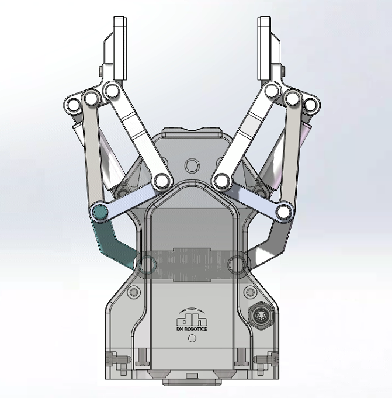
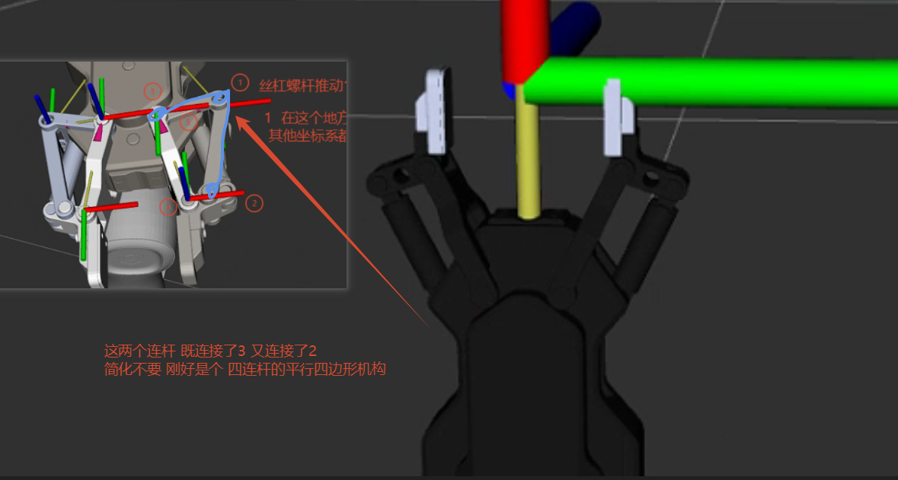
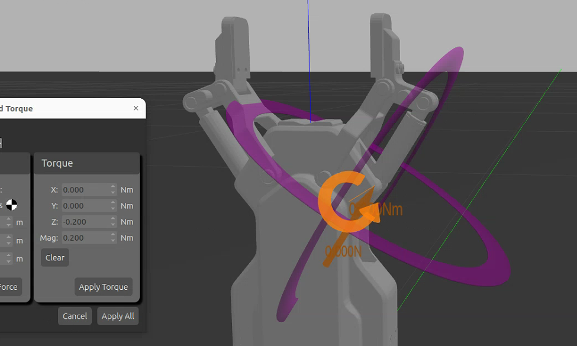

# DH Robotics AG165-90 — ROS 2 / Gazebo SDF Closed Loop

**上游参考：** [DH-Robotics/dh_gripper_ros](https://github.com/DH-Robotics/dh_gripper_ros) 是大寰 GitHub 组织当前公开的官方夹爪 ROS 仓库。它提供的是 ROS 1 元包，并包含 AG95、AG145 等型号；官方组织当前没有公开 AG165-90 专用包，也没有可确认的官方 ROS 2 更新版。第三方 ROS 2 移植不应标注为官方。本项目基于大寰夹爪的公开建模/接口资料，针对 **AG165-90** 独立完成模型整理、URDF 树状建模和 Gazebo SDF 物理闭环扩展；详情见 [官方上游参考](docs/官方上游参考.md)。



This repository packages the CR7AS-mounted DH Robotics AG165-90 gripper assets used for ROS 2 Humble and Gazebo Classic development. It preserves the source CAD assembly, ROS 2 robot-description and MoveIt configuration packages, and the validated SDF closed-loop reference.

## Contents

```text
CAD/SolidWorks/CR7AS+AG165-90/        Original SolidWorks parts and assemblies
ROS2/src/cr7as_grasp/                 URDF/Xacro, AG165 meshes, SDF model, plugins and controllers
ROS2/src/cr7as_grasp_moveit_config/   MoveIt 2 configuration for the CR7AS + AG165 integration
docs/                                 Closed-loop architecture, validation and migration notes
assets/images/                         README illustrations
```

The independent Gazebo model is at `ROS2/src/cr7as_grasp/models/ag165_90_4/model.sdf`. The six-link tree used by ROS/MoveIt is defined in `ROS2/src/cr7as_grasp/urdf/ag165_macro.xacro`; the Gazebo-only SDF pins close the four-bar linkage at simulation time.

## URDF tree and SDF closed-loop model

Each side of the AG165-90 is a four-bar linkage. ROS/MoveIt requires a tree, so the URDF retains six tree joints and models only the parent-child structure used by TF, planning and `ros2_control`.



Gazebo then adds the two SDF-only `link2 ↔ link3` pin joints to restore the physical closed loop. The right active joint follows the left active joint through a PD mimic plugin; the passive joints remain state-only.



## Demonstration

[观看抓取演示视频（MP4）](assets/videos/grasp.mp4)。该视频用于展示当前仿真/演示结果，不替代闭环物理抓取、碰撞或真机验收。

## Important model boundary

URDF/MoveIt use a tree: only `ag165_joint1_left` receives ROS 2 position commands. Gazebo closes each finger's four-bar linkage using SDF pin joints, while a PD mimic plugin drives `ag165_joint1_right`. Do not command the five passive AG165 joints or add the SDF closure pins to a MoveIt planning group.

See [the closed-loop guide](docs/AG165_SDF闭环_架构坐标与故障复盘学习指南.md) for coordinate conventions, control ownership, validated parameters and troubleshooting gates.

## Large files

SolidWorks and mesh files are stored with Git LFS. After cloning, install and enable Git LFS before fetching the project files:

```bash
git lfs install
git clone https://github.com/wky-1-dotcom/dahuan-ag165-90-ros2.git
cd dahuan-ag165-90-ros2
git lfs pull
```

## STEP notice

No AG165-90 `.stp` or `.step` source was supplied in the source folders used to create this repository. The `CAD/SolidWorks` directory intentionally preserves the original SolidWorks source instead. Add an exported AG165 STEP file later under `CAD/STEP/` when it is available.

## ROS 2 usage

The current files target ROS 2 Humble with Gazebo Classic. Read `docs/Ubuntu迁移与验证.md` before building or launching, and keep generated `build/`, `install/`, and `log/` directories outside version control.
